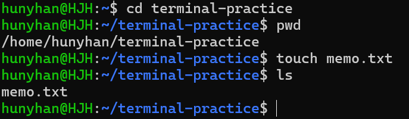
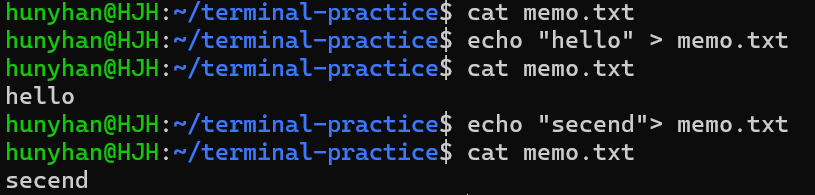
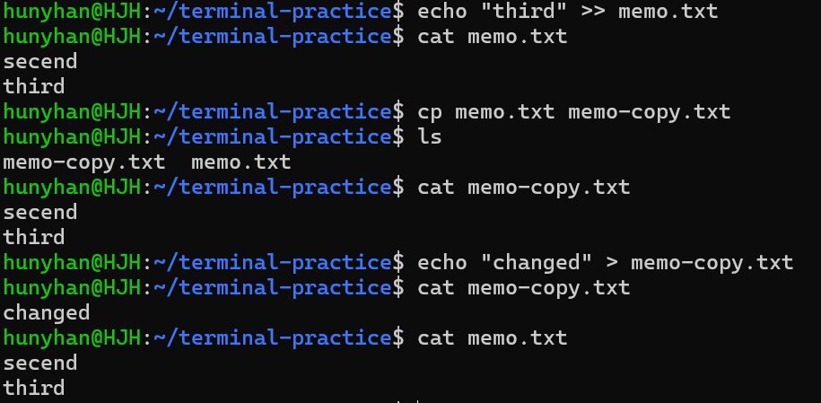
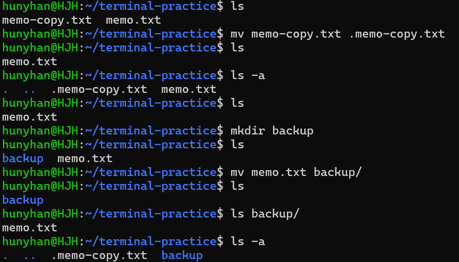
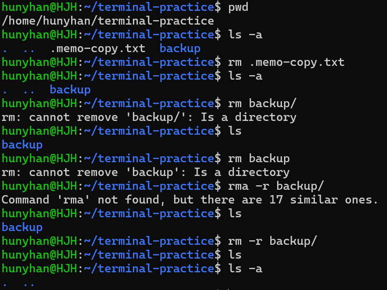

# 터미널 조작 로그

[← README로 돌아가기](../README.md)

실습 폴더: `~/terminal-practice`



<details>
<summary>화면 원문</summary>

```text
hunyhan@HJH:~$ cd terminal-practice
hunyhan@HJH:~/terminal-practice$ pwd
/home/hunyhan/terminal-practice
hunyhan@HJH:~/terminal-practice$ touch memo.txt
hunyhan@HJH:~/terminal-practice$ ls
memo.txt
hunyhan@HJH:~/terminal-practice$
```

</details>



<details>
<summary>화면 원문</summary>

```text
hunyhan@HJH:~/terminal-practice$ cat memo.txt
hunyhan@HJH:~/terminal-practice$ echo "hello" > memo.txt
hunyhan@HJH:~/terminal-practice$ cat memo.txt
hello
hunyhan@HJH:~/terminal-practice$ echo "secend"> memo.txt
hunyhan@HJH:~/terminal-practice$ cat memo.txt
secend
```

</details>



<details>
<summary>화면 원문</summary>

```text
hunyhan@HJH:~/terminal-practice$ echo "third" >> memo.txt
hunyhan@HJH:~/terminal-practice$ cat memo.txt
secend
third
hunyhan@HJH:~/terminal-practice$ cp memo.txt memo-copy.txt
hunyhan@HJH:~/terminal-practice$ ls
memo-copy.txt  memo.txt
hunyhan@HJH:~/terminal-practice$ cat memo-copy.txt
secend
third
hunyhan@HJH:~/terminal-practice$ echo "changed" > memo-copy.txt
hunyhan@HJH:~/terminal-practice$ cat memo-copy.txt
changed
hunyhan@HJH:~/terminal-practice$ cat memo.txt
secend
third
```

</details>



<details>
<summary>화면 원문</summary>

```text
hunyhan@HJH:~/terminal-practice$ ls
memo-copy.txt  memo.txt
hunyhan@HJH:~/terminal-practice$ mv memo-copy.txt .memo-copy.txt
hunyhan@HJH:~/terminal-practice$ ls
memo.txt
hunyhan@HJH:~/terminal-practice$ ls -a
.  ..  .memo-copy.txt  memo.txt
hunyhan@HJH:~/terminal-practice$ ls
memo.txt
hunyhan@HJH:~/terminal-practice$ mkdir backup
hunyhan@HJH:~/terminal-practice$ ls
backup  memo.txt
hunyhan@HJH:~/terminal-practice$ mv memo.txt backup/
hunyhan@HJH:~/terminal-practice$ ls
backup
hunyhan@HJH:~/terminal-practice$ ls backup/
memo.txt
hunyhan@HJH:~/terminal-practice$ ls -a
.  ..  .memo-copy.txt  backup
```

</details>



<details>
<summary>화면 원문</summary>

```text
hunyhan@HJH:~/terminal-practice$ pwd
/home/hunyhan/terminal-practice
hunyhan@HJH:~/terminal-practice$ ls -a
.  ..  .memo-copy.txt  backup
hunyhan@HJH:~/terminal-practice$ rm .memo-copy.txt
hunyhan@HJH:~/terminal-practice$ ls -a
.  ..  backup
hunyhan@HJH:~/terminal-practice$ rm backup/
rm: cannot remove 'backup/': Is a directory
hunyhan@HJH:~/terminal-practice$ ls
backup
hunyhan@HJH:~/terminal-practice$ rm backup
rm: cannot remove 'backup': Is a directory
hunyhan@HJH:~/terminal-practice$ rma -r backup/
Command 'rma' not found, but there are 17 similar ones.
hunyhan@HJH:~/terminal-practice$ ls
backup
hunyhan@HJH:~/terminal-practice$ rm -r backup/
hunyhan@HJH:~/terminal-practice$ ls
hunyhan@HJH:~/terminal-practice$ ls -a
.  ..
```

</details>
