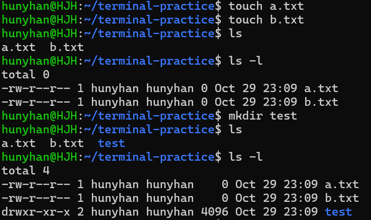
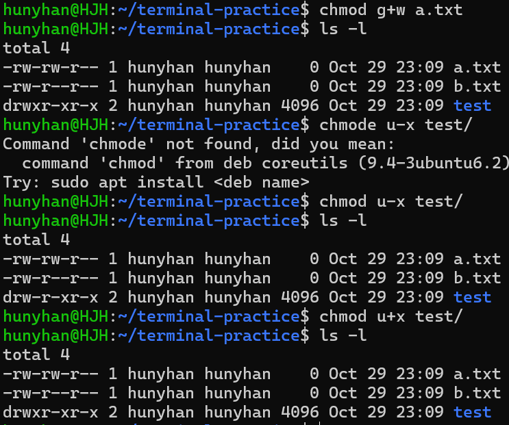
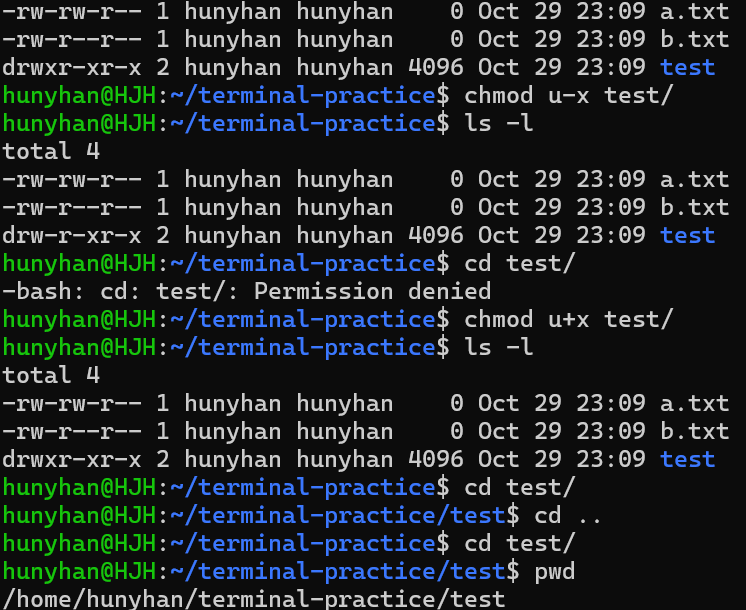
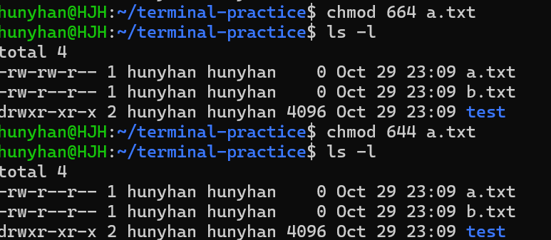

# 권한 실습

[← README로 돌아가기](../README.md)

| 대상 | 변경 | 결과 |
|------|------|------|
| 파일 `a.txt` | `644` → `664` → `644` | 그룹 쓰기 권한 추가 후 복구 |
| 폴더 `test` | `755` → `655` → `755` | 주인의 `x`를 빼면 `cd`가 거절됨 |



<details>
<summary>화면 원문</summary>

```text
hunyhan@HJH:~/terminal-practice$ touch a.txt
hunyhan@HJH:~/terminal-practice$ touch b.txt
hunyhan@HJH:~/terminal-practice$ ls
a.txt  b.txt
hunyhan@HJH:~/terminal-practice$ ls -l
total 0
-rw-r--r-- 1 hunyhan hunyhan 0 Oct 29 23:09 a.txt
-rw-r--r-- 1 hunyhan hunyhan 0 Oct 29 23:09 b.txt
hunyhan@HJH:~/terminal-practice$ mkdir test
hunyhan@HJH:~/terminal-practice$ ls
a.txt  b.txt  test
hunyhan@HJH:~/terminal-practice$ ls -l
total 4
-rw-r--r-- 1 hunyhan hunyhan    0 Oct 29 23:09 a.txt
-rw-r--r-- 1 hunyhan hunyhan    0 Oct 29 23:09 b.txt
drwxr-xr-x 2 hunyhan hunyhan 4096 Oct 29 23:09 test
```

</details>



<details>
<summary>화면 원문</summary>

```text
hunyhan@HJH:~/terminal-practice$ chmod g+w a.txt
hunyhan@HJH:~/terminal-practice$ ls -l
total 4
-rw-rw-r-- 1 hunyhan hunyhan    0 Oct 29 23:09 a.txt
-rw-r--r-- 1 hunyhan hunyhan    0 Oct 29 23:09 b.txt
drwxr-xr-x 2 hunyhan hunyhan 4096 Oct 29 23:09 test
hunyhan@HJH:~/terminal-practice$ chmode u-x test/
Command 'chmode' not found, did you mean:
  command 'chmod' from deb coreutils (9.4-3ubuntu6.2)
Try: sudo apt install <deb name>
hunyhan@HJH:~/terminal-practice$ chmod u-x test/
hunyhan@HJH:~/terminal-practice$ ls -l
total 4
-rw-rw-r-- 1 hunyhan hunyhan    0 Oct 29 23:09 a.txt
-rw-r--r-- 1 hunyhan hunyhan    0 Oct 29 23:09 b.txt
drw-r-xr-x 2 hunyhan hunyhan 4096 Oct 29 23:09 test
hunyhan@HJH:~/terminal-practice$ chmod u+x test/
hunyhan@HJH:~/terminal-practice$ ls -l
total 4
-rw-rw-r-- 1 hunyhan hunyhan    0 Oct 29 23:09 a.txt
-rw-r--r-- 1 hunyhan hunyhan    0 Oct 29 23:09 b.txt
drwxr-xr-x 2 hunyhan hunyhan 4096 Oct 29 23:09 test
```

</details>



<details>
<summary>화면 원문</summary>

```text
-rw-rw-r-- 1 hunyhan hunyhan    0 Oct 29 23:09 a.txt
-rw-r--r-- 1 hunyhan hunyhan    0 Oct 29 23:09 b.txt
drwxr-xr-x 2 hunyhan hunyhan 4096 Oct 29 23:09 test
hunyhan@HJH:~/terminal-practice$ chmod u-x test/
hunyhan@HJH:~/terminal-practice$ ls -l
total 4
-rw-rw-r-- 1 hunyhan hunyhan    0 Oct 29 23:09 a.txt
-rw-r--r-- 1 hunyhan hunyhan    0 Oct 29 23:09 b.txt
drw-r-xr-x 2 hunyhan hunyhan 4096 Oct 29 23:09 test
hunyhan@HJH:~/terminal-practice$ cd test/
-bash: cd: test/: Permission denied
hunyhan@HJH:~/terminal-practice$ chmod u+x test/
hunyhan@HJH:~/terminal-practice$ ls -l
total 4
-rw-rw-r-- 1 hunyhan hunyhan    0 Oct 29 23:09 a.txt
-rw-r--r-- 1 hunyhan hunyhan    0 Oct 29 23:09 b.txt
drwxr-xr-x 2 hunyhan hunyhan 4096 Oct 29 23:09 test
hunyhan@HJH:~/terminal-practice$ cd test/
hunyhan@HJH:~/terminal-practice/test$ cd ..
hunyhan@HJH:~/terminal-practice$ cd test/
hunyhan@HJH:~/terminal-practice/test$ pwd
/home/hunyhan/terminal-practice/test
```

</details>



<details>
<summary>화면 원문</summary>

```text
hunyhan@HJH:~/terminal-practice$ chmod 664 a.txt
hunyhan@HJH:~/terminal-practice$ ls -l
total 4
-rw-rw-r-- 1 hunyhan hunyhan    0 Oct 29 23:09 a.txt
-rw-r--r-- 1 hunyhan hunyhan    0 Oct 29 23:09 b.txt
drwxr-xr-x 2 hunyhan hunyhan 4096 Oct 29 23:09 test
hunyhan@HJH:~/terminal-practice$ chmod 644 a.txt
hunyhan@HJH:~/terminal-practice$ ls -l
total 4
-rw-r--r-- 1 hunyhan hunyhan    0 Oct 29 23:09 a.txt
-rw-r--r-- 1 hunyhan hunyhan    0 Oct 29 23:09 b.txt
drwxr-xr-x 2 hunyhan hunyhan 4096 Oct 29 23:09 test
```

</details>
