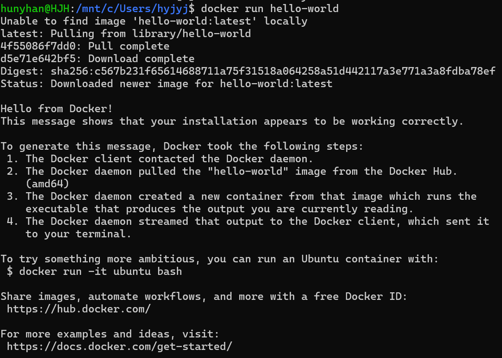
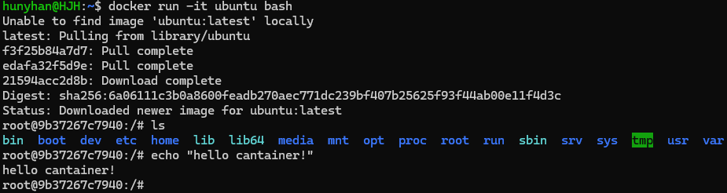

# Docker 운영과 컨테이너 실습

[← README로 돌아가기](../README.md)

## 운영 명령

지난 프로젝트의 컨테이너가 함께 보이지 않도록 내 실습 항목만 골라서 출력했습니다.

```text
$ docker images my-nginx
IMAGE         ID             DISK USAGE   CONTENT SIZE   EXTRA
my-nginx:v1   88c5e954ea31        241MB         63.9MB    U
my-nginx:v2   e42d86e615ca        251MB         68.8MB    U
my-nginx:v3   4907b8531fed        241MB         63.9MB    U

$ docker ps -a --filter name=my-nginx
CONTAINER ID   IMAGE          COMMAND                  CREATED          STATUS          PORTS                                     NAMES
bb3269ef1666   my-nginx:v3    "/docker-entrypoint.…"   42 minutes ago   Up 42 minutes   0.0.0.0:8083->80/tcp, [::]:8083->80/tcp   my-nginx-v3
c3f43d634abe   nginx          "/docker-entrypoint.…"   2 days ago       Up 2 days       0.0.0.0:8082->80/tcp, [::]:8082->80/tcp   my-nginx-bind
60c006875c0f   d860cbcaa923   "/docker-entrypoint.…"   2 days ago       Up 2 days       0.0.0.0:8081->80/tcp, [::]:8081->80/tcp   my-nginx-v2
77b843f40121   my-nginx:v1    "/docker-entrypoint.…"   3 days ago       Up 3 days       0.0.0.0:8080->80/tcp, [::]:8080->80/tcp   my-nginx-v1
4f3339587535   nginx          "/docker-entrypoint.…"   3 days ago       Up 3 days       80/tcp                                    my-nginx

$ docker logs --tail 5 my-nginx-v3
172.17.0.1 - - [05/Nov/2026:15:15:01 +0000] "GET /glossary.html HTTP/1.1" 200 53387 "-" "Mozilla/5.0 (Windows NT 10.0; Win64; x64) AppleWebKit/537.36 (KHTML, like Gecko) Chrome/156.0.0.0 Safari/537.36" "-"
172.17.0.1 - - [05/Nov/2026:15:15:02 +0000] "GET /style.css HTTP/1.1" 304 0 "http://localhost:8083/glossary.html" "Mozilla/5.0 (Windows NT 10.0; Win64; x64) AppleWebKit/537.36 (KHTML, like Gecko) Chrome/156.0.0.0 Safari/537.36" "-"
(이하 같은 형식 3줄)

$ docker stats --no-stream my-nginx-v3
CONTAINER ID   NAME          CPU %     MEM USAGE / LIMIT     MEM %     NET I/O           BLOCK I/O     PIDS
bb3269ef1666   my-nginx-v3   0.00%     12.95MiB / 15.34GiB   0.08%     30.1kB / 80.8kB   0B / 12.3kB   17
```

`my-nginx-v2` 줄의 IMAGE가 이름 대신 ID로 나오는 이유: 컨테이너를 만든 뒤 `my-nginx:v2`를 다시 빌드해서 이름이 새 이미지로 옮겨 갔기 때문입니다.

## 컨테이너 실행



<details>
<summary>화면 원문</summary>

```text
hunyhan@HJH:/mnt/c/Users/hyjyj$ docker run hello-world
Unable to find image 'hello-world:latest' locally
latest: Pulling from library/hello-world
4f55086f7dd0: Pull complete
d5e71e642bf5: Download complete
Digest: sha256:c567b231f65614688711a75f31518a064258a51d442117a3e771a3a8fdba78ef
Status: Downloaded newer image for hello-world:latest

Hello from Docker!
This message shows that your installation appears to be working correctly.

To generate this message, Docker took the following steps:
 1. The Docker client contacted the Docker daemon.
 2. The Docker daemon pulled the "hello-world" image from the Docker Hub.
    (amd64)
 3. The Docker daemon created a new container from that image which runs the
    executable that produces the output you are currently reading.
 4. The Docker daemon streamed that output to the Docker client, which sent it
    to your terminal.

To try something more ambitious, you can run an Ubuntu container with:
 $ docker run -it ubuntu bash

Share images, automate workflows, and more with a free Docker ID:
 https://hub.docker.com/

For more examples and ideas, visit:
 https://docs.docker.com/get-started/
```

</details>



<details>
<summary>화면 원문</summary>

```text
hunyhan@HJH:~$ docker run -it ubuntu bash
Unable to find image 'ubuntu:latest' locally
latest: Pulling from library/ubuntu
f3f25b84a7d7: Pull complete
edafa32f5d9e: Pull complete
21594acc2d8b: Download complete
Digest: sha256:6a06111c3b0a8600feadb270aec771dc239bf407b25625f93f44ab00e11f4d3c
Status: Downloaded newer image for ubuntu:latest
root@9b37267c7940:/# ls
bin  boot  dev  etc  home  lib  lib64  media  mnt  opt  proc  root  run  sbin  srv  sys  tmp  usr  var
root@9b37267c7940:/# echo "hello cantainer!"
hello cantainer!
root@9b37267c7940:/#
```

</details>

## attach와 exec 관찰

| 실험 | 결과 |
|------|------|
| `docker start -ai`로 붙은 메인 `bash`를 먼저 `exit` | `exec`로 띄운 `bash`도 끝나고 컨테이너는 `Exited (0)` |
| `docker exec -it`로 띄운 `bash`를 먼저 `exit` | 메인 `bash`가 살아 있어 컨테이너는 `Up` |

정리: "원래 있던 메인 프로그램에 연결 되는건 attach, 새로 띄우는 던 exec 다."
