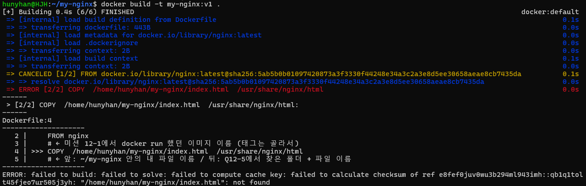

# Dockerfile과 커스텀 이미지

[← README로 돌아가기](../README.md)

## 선택한 베이스

방식 (A), 웹 서버 베이스 이미지 + 정적 콘텐츠. 베이스는 `nginx`입니다.

설명서는 HTML 파일이라 브라우저로 보여 주려면 서버가 필요하다. 그래서 웹 서버인 nginx를 베이스로 골랐다.

## 커스텀 포인트

| 무엇을 | 어디에 | 목적 |
|------|------|------|
| `site/` (설명서) | `/usr/share/nginx/html` | NGINX `default.conf`의 `root`가 가리키는 폴더라서, 이 위치의 파일을 내보낸다 |

[Dockerfile](../my-nginx/Dockerfile) · [웹 소스](../my-nginx/site/index.html)

## 빌드와 실행

```text
$ docker build -t my-nginx:v3 .
[+] Building 0.7s (7/7) FINISHED
 => => transferring context: 76.13kB
 => CACHED [1/2] FROM docker.io/library/nginx:latest@sha256:5ab5b0b01097420873a3f3330f44248e34a3c2a3e8d5ee30658aeae8cb7435da
 => [2/2] COPY  site/  /usr/share/nginx/html
 => => naming to docker.io/library/my-nginx:v3

$ docker run -d --name my-nginx-v3 -p 8083:80 my-nginx:v3
```

빌드 출력은 핵심 줄만 옮겼습니다.

## 빌드 폴더 기준 경로

`COPY` 앞 경로는 빌드 폴더 안에서 찾습니다. 절대 경로로 쓴 첫 시도는 실패했습니다.



<details>
<summary>화면 원문</summary>

```text
hunyhan@HJH:~/my-nginx$ docker build -t my-nginx:v1 .
[+] Building 0.4s (6/6) FINISHED                                                  docker:default
 => [internal] load build definition from Dockerfile                                        0.1s
 => => transferring dockerfile: 443B                                                        0.0s
 => [internal] load metadata for docker.io/library/nginx:latest                             0.0s
 => [internal] load .dockerignore                                                           0.1s
 => => transferring context: 2B                                                             0.0s
 => [internal] load build context                                                           0.1s
 => => transferring context: 2B                                                             0.0s
 => CANCELED [1/2] FROM docker.io/library/nginx:latest@sha256:5ab5b0b01097420873a3f3330f44248e34a3c2a3e8d5ee30658aeae8cb7435da  0.1s
 => => resolve docker.io/library/nginx:latest@sha256:5ab5b0b01097420873a3f3330f44248e34a3c2a3e8d5ee30658aeae8cb7435da  0.0s
 => ERROR [2/2] COPY  /home/hunyhan/my-nginx/index.html  /usr/share/nginx/html              0.0s
------
 > [2/2] COPY  /home/hunyhan/my-nginx/index.html  /usr/share/nginx/html:
------
Dockerfile:4
--------------------
   2 |     FROM nginx
   3 |     # ← 미션 12-1에서 docker run 했던 이미지 이름 (태그는 골라서)
   4 | >>> COPY  /home/hunyhan/my-nginx/index.html  /usr/share/nginx/html
   5 |     # ← 앞: ~/my-nginx 안의 내 파일 이름 / 뒤: Q12-5에서 찾은 폴더 + 파일 이름
--------------------
ERROR: failed to build: failed to solve: failed to compute cache key: failed to calculate checksum of ref e8fef0juv0wu3b294ml943imh::qb1q1tolt45fjeo7ur505j3yh: "/home/hunyhan/my-nginx/index.html": not found
```

</details>

## 원본과 복사본 비교

설명서 원본을 저장소로 복사한 뒤 `diff`로 확인했습니다.

```text
$ diff -r /mnt/d/OneDrive/05_Codyssey/01_Week/site site
diff -r /mnt/d/OneDrive/05_Codyssey/01_Week/site/style.css site/style.css
53d52
<   flex-wrap: wrap;
55a55
>   overflow-x: auto;
147c147
<   .toc { flex-wrap: nowrap; justify-content: flex-start; overflow-x: auto; }
---
>   .toc { justify-content: flex-start; }
$ cp -r /mnt/d/OneDrive/05_Codyssey/01_Week/site .
$ diff -r /mnt/d/OneDrive/05_Codyssey/01_Week/site site
```

복사 후 `diff`는 아무것도 출력하지 않았습니다. 두 폴더의 내용이 같다는 뜻입니다.

## 변경 흐름

`site/` 수정 → 저장소로 복사 → `docker build` → 기존 컨테이너 `stop`, `rm` → 새 이미지로 `run`.

## 결론

이미지는 틀이고, `FROM`이 그 틀을 가져온다. `COPY`는 내가 보여주고 싶은 파일을 nginx가 내보내는 폴더 경로에 붙여 넣는다. `CACHED`는 바뀌지 않은 단계는 이전 결과를 다시 쓴다는 뜻이다.
