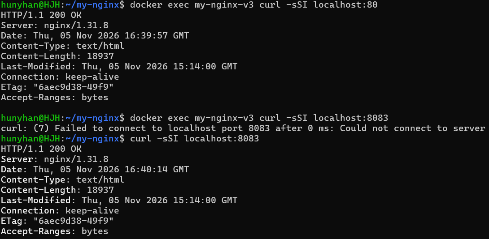
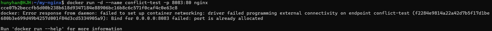
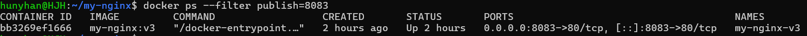
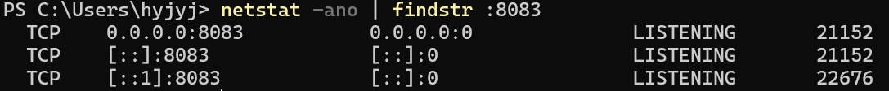
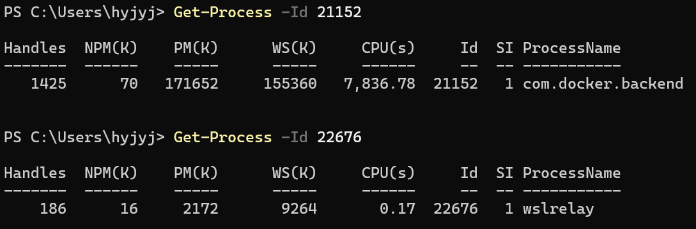
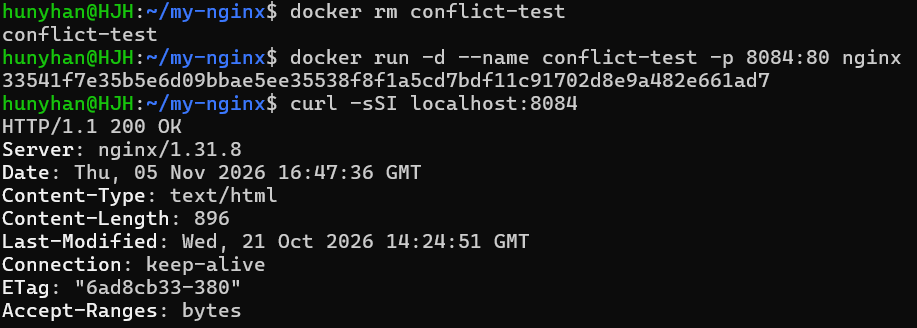
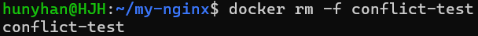

# 포트 매핑

[← README로 돌아가기](../README.md)

```bash
docker run -d --name my-nginx-v3 -p 8083:80 my-nginx:v3
```

`-p 8083:80`은 호스트 8083번으로 들어온 요청을 컨테이너의 80번으로 보냅니다.

```text
NAMES         PORTS
my-nginx-v3   0.0.0.0:8083->80/tcp, [::]:8083->80/tcp
my-nginx      80/tcp
```

`my-nginx`처럼 화살표가 없으면 내 컴퓨터에서 접속할 수 없습니다.


<details>
<summary>화면 원문</summary>

```text
localhost:8083/index.html
개발 작업실 설명서
터미널, Docker, Git을 쓸 때 찾아보는 문서입니다. 주제마다 핵심을 먼저 적고, 심화 내용은 접어 두었습니다.
용어집 바로가기 →
실행 환경 / 경로와 터미널 / 권한 / Docker 구조 / 커스텀 이미지 / 컨테이너 운영 / 포트 매핑 / 바인드 마운트 / 볼륨 / Git과 GitHub
실행 환경
구성 / 역할
Windows: 내 컴퓨터의 OS. PowerShell, VSCode, Docker Desktop을 실행한다
WSL2: Windows 안에서 리눅스를 실행하는 기능
Ubuntu-24.04: WSL2에 설치한 리눅스 배포판
Git Bash: Windows에서 쓰는 bash 터미널. 프롬프트에 MINGW64가 보인다
Windows와 Ubuntu는 사용자, 프로그램, 설정이 따로 있다. 지금 어느 쪽에 있는지는 프롬프트로 확인한다.
▶ 심화: 어디서 실행되는 프로그램인지 확인하기
경로와 터미널
(이하 생략)
```

</details>


<details>
<summary>화면 원문</summary>

```text
localhost:8083/glossary.html
용어집
← 설명서로 돌아가기 · Ctrl + F로 찾을 수 있습니다.
터미널·리눅스 / WSL / Docker / Git·GitHub / 개발 일반
터미널·리눅스
용어 / 뜻 / 예
터미널 (Terminal): 글자로 명령을 입력하고 결과를 글자로 보는 창이다. 명령을 실제로 처리하는 것은 그 안에서 실행되는 프로그램이다.
PowerShell (PS): Windows에 들어 있는 터미널 프로그램(셸)이다. 프롬프트 앞의 PS가 PowerShell이라는 표시다.
프롬프트 (Prompt): 터미널이 "명령을 입력하세요"라고 보여 주는 앞부분이다. 지금 어느 터미널인지, 누구로, 어느 폴더에 있는지를 알려 준다.
관리자 권한: 시스템 설정을 바꿀 수 있는 높은 권한이다. Windows에서는 "관리자로 실행"한 PowerShell이 이 권한을 가진다. / 프롬프트가 C:\Windows\system32에서 시작하면 관리자 PowerShell일 가능성이 높다.
커널 (Kernel): 운영체제의 핵심이다. 하드웨어(CPU, 메모리, 디스크)를 직접 다루고 프로그램이 그것을 쓰게 해 준다.
(이하 생략)
```

</details>

## 네트워크 격리와 포트 포워딩 원리

컨테이너는 **네트워크 네임스페이스**로 호스트와 나뉜 자기 네트워크 공간을 가집니다. IP 주소와 포트 목록이 호스트와 따로 있어서, 여러 컨테이너가 각자 80번을 써도 겹치지 않습니다.

```text
브라우저 → 호스트 8083번 → Docker 포트 포워딩 → 브리지 네트워크 → 컨테이너 80번 → nginx
```

`localhost`는 명령을 실행한 그 자리를 가리킵니다. 컨테이너 안에서는 nginx가 기다리는 80번으로 접속되고, 8083번은 호스트 쪽 번호라서 없습니다. 호스트에서는 Docker가 8083번으로 받아서 컨테이너의 80번으로 넘깁니다.

| 실행한 곳 | 명령 | 결과 |
|------|------|------|
| 컨테이너 안 | `curl localhost:80` | `200 OK` |
| 컨테이너 안 | `curl localhost:8083` | 연결 실패 |
| 호스트 | `curl localhost:8083` | `200 OK` |



<details>
<summary>화면 원문</summary>

```text
hunyhan@HJH:~/my-nginx$ docker exec my-nginx-v3 curl -sSI localhost:80
HTTP/1.1 200 OK
Server: nginx/1.31.8
Date: Thu, 05 Nov 2026 16:39:57 GMT
Content-Type: text/html
Content-Length: 18937
Last-Modified: Thu, 05 Nov 2026 15:14:00 GMT
Connection: keep-alive
ETag: "6aec9d38-49f9"
Accept-Ranges: bytes

hunyhan@HJH:~/my-nginx$ docker exec my-nginx-v3 curl -sSI localhost:8083
curl: (7) Failed to connect to localhost port 8083 after 0 ms: Could not connect to server
hunyhan@HJH:~/my-nginx$ curl -sSI localhost:8083
HTTP/1.1 200 OK
Server: nginx/1.31.8
Date: Thu, 05 Nov 2026 16:40:14 GMT
Content-Type: text/html
Content-Length: 18937
Last-Modified: Thu, 05 Nov 2026 15:14:00 GMT
Connection: keep-alive
ETag: "6aec9d38-49f9"
Accept-Ranges: bytes
```

</details>

컨테이너 로그의 출발지가 내 PC가 아니라 브리지 쪽 주소 `172.17.0.1`로 찍히는 것도 요청이 이 경로로 들어오기 때문입니다.

## 포트 충돌 진단 절차

| 순서 | 할 일 | 이유 |
|------|------|------|
| 1 | 에러 문구로 포트 번호 확인 | 어떤 포트가 겹쳤는지 찾는다 |
| 2 | `docker ps --filter publish=포트` | 원인이 내 컨테이너인지 구분한다 |
| 3 | `netstat -ano`, `Get-Process -Id PID` | 어떤 프로그램이 듣고 있는지 찾는다 |
| 4 | 다른 포트를 쓰거나, 내 것이 확실할 때만 중지 | 다른 프로그램을 끄지 않는다 |

### 1. 충돌 재현



<details>
<summary>화면 원문</summary>

```text
hunyhan@HJH:~/my-nginx$ docker run -d --name conflict-test -p 8083:80 nginx
cce07b2beccfb5d00b238b618d9347184e88906bc16b8c6c571f0caf4c0e63c8
docker: Error response from daemon: failed to set up container networking: driver failed programming external connectivity on endpoint conflict-test (f2284e9814a22a42d7b5f17d1be680b3e699d49b4257d001f84d3cd5334905a9): Bind for 0.0.0.0:8083 failed: port is already allocated

Run 'docker run --help' for more information
```

</details>

### 2. 내 컨테이너인지 확인



<details>
<summary>화면 원문</summary>

```text
hunyhan@HJH:~/my-nginx$ docker ps --filter publish=8083
CONTAINER ID   IMAGE         COMMAND                  CREATED       STATUS       PORTS                                     NAMES
bb3269ef1666   my-nginx:v3   "/docker-entrypoint.…"   2 hours ago   Up 2 hours   0.0.0.0:8083->80/tcp, [::]:8083->80/tcp   my-nginx-v3
```

</details>

### 3. Windows에서 프로세스 확인



<details>
<summary>화면 원문</summary>

```text
PS C:\Users\hyjyj> netstat -ano | findstr :8083
  TCP    0.0.0.0:8083           0.0.0.0:0              LISTENING       21152
  TCP    [::]:8083              [::]:0                 LISTENING       21152
  TCP    [::1]:8083             [::]:0                 LISTENING       22676
```

</details>



<details>
<summary>화면 원문</summary>

```text
PS C:\Users\hyjyj> Get-Process -Id 21152

Handles  NPM(K)    PM(K)      WS(K)     CPU(s)     Id  SI ProcessName
-------  ------    -----      -----     ------     --  -- -----------
   1425      70   171652     155360   7,836.78  21152   1 com.docker.backend

PS C:\Users\hyjyj> Get-Process -Id 22676

Handles  NPM(K)    PM(K)      WS(K)     CPU(s)     Id  SI ProcessName
-------  ------    -----      -----     ------     --  -- -----------
    186      16     2172       9264       0.17  22676   1 wslrelay
```

</details>

8083번을 듣는 프로그램은 Docker Desktop(`com.docker.backend`)과 WSL 중계(`wslrelay`)입니다. 프로세스를 끄지 않고, 2번에서 찾은 컨테이너가 쓰는 포트임을 확인했습니다.

### 4. 해결: 다른 포트 사용



<details>
<summary>화면 원문</summary>

```text
hunyhan@HJH:~/my-nginx$ docker rm conflict-test
conflict-test
hunyhan@HJH:~/my-nginx$ docker run -d --name conflict-test -p 8084:80 nginx
33541f7e35b5e6d09bbae5ee35538f8f1a5cd7bdf11c91702d8e9a482e661ad7
hunyhan@HJH:~/my-nginx$ curl -sSI localhost:8084
HTTP/1.1 200 OK
Server: nginx/1.31.8
Date: Thu, 05 Nov 2026 16:47:36 GMT
Content-Type: text/html
Content-Length: 896
Last-Modified: Wed, 21 Oct 2026 14:24:51 GMT
Connection: keep-alive
ETag: "6ad8cb33-380"
Accept-Ranges: bytes
```

</details>



<details>
<summary>화면 원문</summary>

```text
hunyhan@HJH:~/my-nginx$ docker rm -f conflict-test
conflict-test
```

</details>
