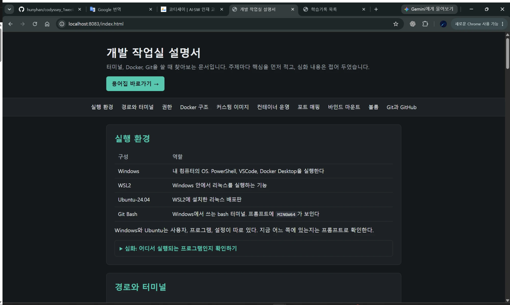
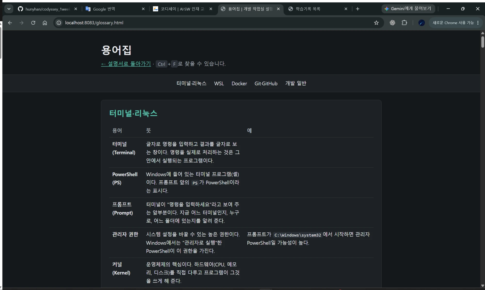

# 포트 매핑

[← README로 돌아가기](../README.md)

```bash
docker run -d --name my-nginx-v3 -p 8083:80 my-nginx:v3
```

`-p 8083:80`은 호스트 8083번으로 들어온 요청을 컨테이너의 80번으로 보냅니다.

```text
NAMES         PORTS
my-nginx-v3   0.0.0.0:8083->80/tcp, [::]:8083->80/tcp
my-nginx      80/tcp
```

`my-nginx`처럼 화살표가 없으면 내 컴퓨터에서 접속할 수 없습니다.



<details>
<summary>화면 원문</summary>

```text
localhost:8083/index.html
개발 작업실 설명서
터미널, Docker, Git을 쓸 때 찾아보는 문서입니다. 주제마다 핵심을 먼저 적고, 심화 내용은 접어 두었습니다.
용어집 바로가기 →
실행 환경 / 경로와 터미널 / 권한 / Docker 구조 / 커스텀 이미지 / 컨테이너 운영 / 포트 매핑 / 바인드 마운트 / 볼륨 / Git과 GitHub
실행 환경
구성 / 역할
Windows: 내 컴퓨터의 OS. PowerShell, VSCode, Docker Desktop을 실행한다
WSL2: Windows 안에서 리눅스를 실행하는 기능
Ubuntu-24.04: WSL2에 설치한 리눅스 배포판
Git Bash: Windows에서 쓰는 bash 터미널. 프롬프트에 MINGW64가 보인다
Windows와 Ubuntu는 사용자, 프로그램, 설정이 따로 있다. 지금 어느 쪽에 있는지는 프롬프트로 확인한다.
▶ 심화: 어디서 실행되는 프로그램인지 확인하기
경로와 터미널
(이하 생략)
```

</details>



<details>
<summary>화면 원문</summary>

```text
localhost:8083/glossary.html
용어집
← 설명서로 돌아가기 · Ctrl + F로 찾을 수 있습니다.
터미널·리눅스 / WSL / Docker / Git·GitHub / 개발 일반
터미널·리눅스
용어 / 뜻 / 예
터미널 (Terminal): 글자로 명령을 입력하고 결과를 글자로 보는 창이다. 명령을 실제로 처리하는 것은 그 안에서 실행되는 프로그램이다.
PowerShell (PS): Windows에 들어 있는 터미널 프로그램(셸)이다. 프롬프트 앞의 PS가 PowerShell이라는 표시다.
프롬프트 (Prompt): 터미널이 "명령을 입력하세요"라고 보여 주는 앞부분이다. 지금 어느 터미널인지, 누구로, 어느 폴더에 있는지를 알려 준다.
관리자 권한: 시스템 설정을 바꿀 수 있는 높은 권한이다. Windows에서는 "관리자로 실행"한 PowerShell이 이 권한을 가진다. / 프롬프트가 C:\Windows\system32에서 시작하면 관리자 PowerShell일 가능성이 높다.
커널 (Kernel): 운영체제의 핵심이다. 하드웨어(CPU, 메모리, 디스크)를 직접 다루고 프로그램이 그것을 쓰게 해 준다.
(이하 생략)
```

</details>
