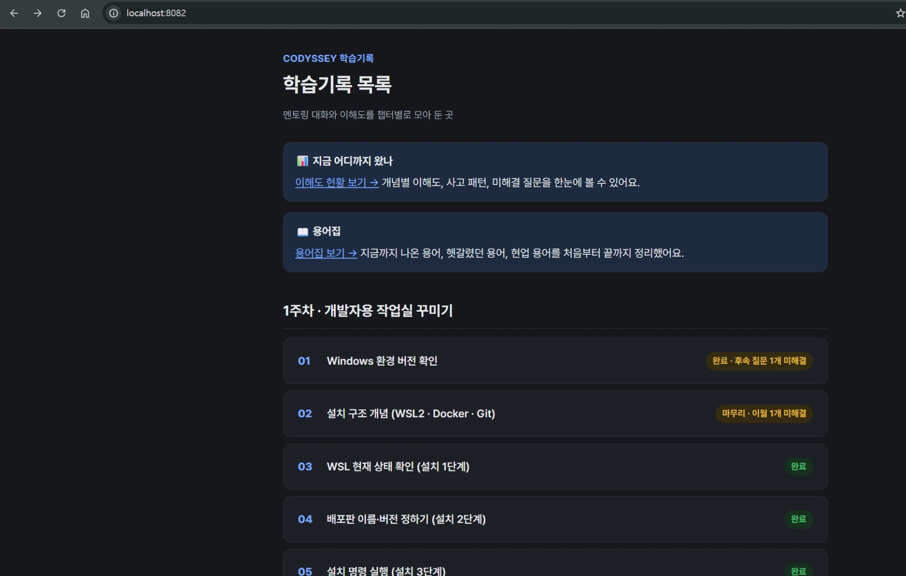
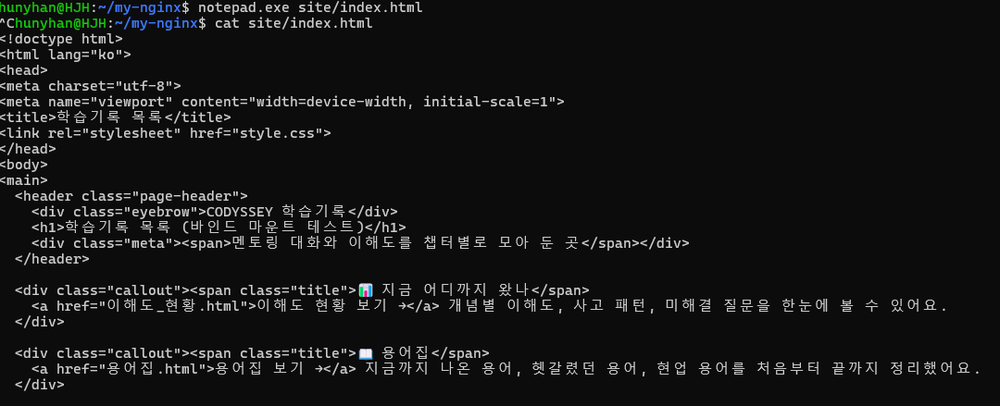
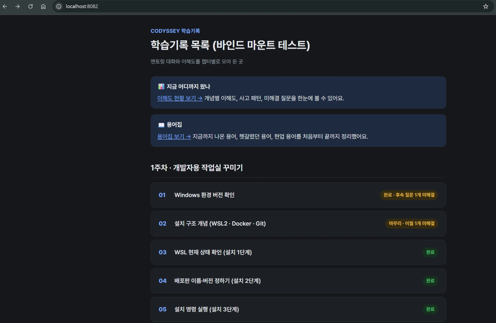

# 바인드 마운트

[← README로 돌아가기](../README.md)

```bash
docker run -d --name my-nginx-bind -p 8082:80 -v /home/hunyhan/my-nginx/site:/usr/share/nginx/html nginx
```

호스트 파일의 `<h1>`을 고치고 브라우저를 새로고침했습니다. 빌드는 다시 하지 않았습니다.

## 변경 전



<details>
<summary>화면 원문</summary>

```text
localhost:8082
CODYSSEY 학습기록
학습기록 목록
멘토링 대화와 이해도를 챕터별로 모아 둔 곳
📊 지금 어디까지 왔나
이해도 현황 보기 → 개념별 이해도, 사고 패턴, 미해결 질문을 한눈에 볼 수 있어요.
📖 용어집
용어집 보기 → 지금까지 나온 용어, 헷갈렸던 용어, 현업 용어를 처음부터 끝까지 정리했어요.
1주차 · 개발자용 작업실 꾸미기
01 Windows 환경 버전 확인 / 완료 · 후속 질문 1개 미해결
02 설치 구조 개념 (WSL2 · Docker · Git) / 마무리 · 이월 1개 미해결
03 WSL 현재 상태 확인 (설치 1단계) / 완료
04 배포판 이름·버전 정하기 (설치 2단계) / 완료
05 설치 명령 실행 (설치 3단계) / 완료
(이하 생략)
```

</details>

## 호스트 파일 수정



<details>
<summary>화면 원문</summary>

```text
hunyhan@HJH:~/my-nginx$ notepad.exe site/index.html
^Chunyhan@HJH:~/my-nginx$ cat site/index.html
<!doctype html>
<html lang="ko">
<head>
<meta charset="utf-8">
<meta name="viewport" content="width=device-width, initial-scale=1">
<title>학습기록 목록</title>
<link rel="stylesheet" href="style.css">
</head>
<body>
<main>
  <header class="page-header">
    <div class="eyebrow">CODYSSEY 학습기록</div>
    <h1>학습기록 목록 (바인드 마운트 테스트)</h1>
    <div class="meta"><span>멘토링 대화와 이해도를 챕터별로 모아 둔 곳</span></div>
  </header>

  <div class="callout"><span class="title">📊 지금 어디까지 왔나</span>
    <a href="이해도_현황.html">이해도 현황 보기 →</a> 개념별 이해도, 사고 패턴, 미해결 질문을 한눈에 볼 수 있어요.
  </div>

  <div class="callout"><span class="title">📖 용어집</span>
    <a href="용어집.html">용어집 보기 →</a> 지금까지 나온 용어, 헷갈렸던 용어, 현업 용어를 처음부터 끝까지 정리했어요.
  </div>
```

</details>

## 변경 후



<details>
<summary>화면 원문</summary>

```text
localhost:8082
CODYSSEY 학습기록
학습기록 목록 (바인드 마운트 테스트)
멘토링 대화와 이해도를 챕터별로 모아 둔 곳
📊 지금 어디까지 왔나
이해도 현황 보기 → 개념별 이해도, 사고 패턴, 미해결 질문을 한눈에 볼 수 있어요.
📖 용어집
용어집 보기 → 지금까지 나온 용어, 헷갈렸던 용어, 현업 용어를 처음부터 끝까지 정리했어요.
1주차 · 개발자용 작업실 꾸미기
01 Windows 환경 버전 확인 / 완료 · 후속 질문 1개 미해결
02 설치 구조 개념 (WSL2 · Docker · Git) / 마무리 · 이월 1개 미해결
03 WSL 현재 상태 확인 (설치 1단계) / 완료
04 배포판 이름·버전 정하기 (설치 2단계) / 완료
05 설치 명령 실행 (설치 3단계) / 완료
(이하 생략)
```

</details>

이 화면들은 실습 당시의 학습기록 페이지입니다. 현재 제출한 `site/`는 설명서로 바뀌었습니다.
