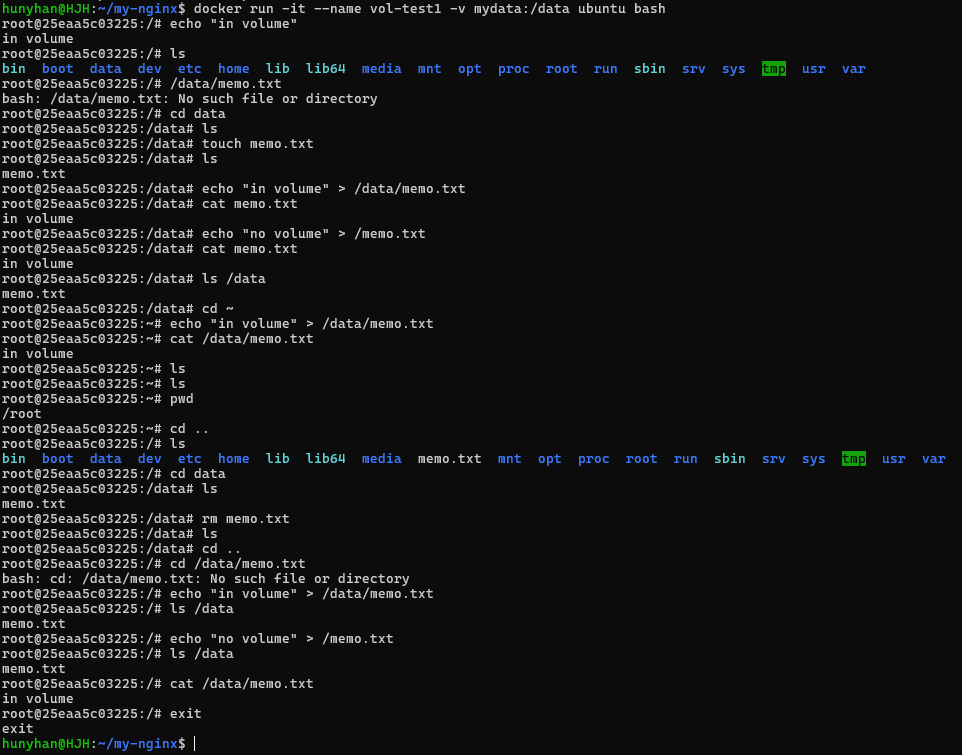
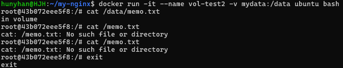

# 볼륨 영속성

[← README로 돌아가기](../README.md)

```bash
docker volume create mydata
docker run -it --name vol-test1 -v mydata:/data ubuntu bash
docker rm vol-test1
docker run -it --name vol-test2 -v mydata:/data ubuntu bash
```

```text
$ docker volume ls --filter name=mydata
DRIVER    VOLUME NAME
local     mydata
```

## 컨테이너 삭제 전



<details>
<summary>화면 원문</summary>

```text
hunyhan@HJH:~/my-nginx$ docker run -it --name vol-test1 -v mydata:/data ubuntu bash
root@25eaa5c03225:/# echo "in volume"
in volume
root@25eaa5c03225:/# ls
bin  boot  data  dev  etc  home  lib  lib64  media  mnt  opt  proc  root  run  sbin  srv  sys  tmp  usr  var
root@25eaa5c03225:/# /data/memo.txt
bash: /data/memo.txt: No such file or directory
root@25eaa5c03225:/# cd data
root@25eaa5c03225:/data# ls
root@25eaa5c03225:/data# touch memo.txt
root@25eaa5c03225:/data# ls
memo.txt
root@25eaa5c03225:/data# echo "in volume" > /data/memo.txt
root@25eaa5c03225:/data# cat memo.txt
in volume
root@25eaa5c03225:/data# echo "no volume" > /memo.txt
root@25eaa5c03225:/data# cat memo.txt
in volume
root@25eaa5c03225:/data# ls /data
memo.txt
root@25eaa5c03225:/data# cd ~
root@25eaa5c03225:~# echo "in volume" > /data/memo.txt
root@25eaa5c03225:~# cat /data/memo.txt
in volume
root@25eaa5c03225:~# ls
root@25eaa5c03225:~# ls
root@25eaa5c03225:~# pwd
/root
root@25eaa5c03225:~# cd ..
root@25eaa5c03225:/# ls
bin  boot  data  dev  etc  home  lib  lib64  media  memo.txt  mnt  opt  proc  root  run  sbin  srv  sys  tmp  usr  var
root@25eaa5c03225:/# cd data
root@25eaa5c03225:/data# ls
memo.txt
root@25eaa5c03225:/data# rm memo.txt
root@25eaa5c03225:/data# ls
root@25eaa5c03225:/data# cd ..
root@25eaa5c03225:/# cd /data/memo.txt
bash: cd: /data/memo.txt: No such file or directory
root@25eaa5c03225:/# echo "in volume" > /data/memo.txt
root@25eaa5c03225:/# ls /data
memo.txt
root@25eaa5c03225:/# echo "no volume" > /memo.txt
root@25eaa5c03225:/# ls /data
memo.txt
root@25eaa5c03225:/# cat /data/memo.txt
in volume
root@25eaa5c03225:/# exit
exit
hunyhan@HJH:~/my-nginx$
```

</details>

## 컨테이너 삭제 후



<details>
<summary>화면 원문</summary>

```text
hunyhan@HJH:~/my-nginx$ docker run -it --name vol-test2 -v mydata:/data ubuntu bash
root@43b072eee5f8:/# cat /data/memo.txt
in volume
root@43b072eee5f8:/# cat /memo.txt
cat: /memo.txt: No such file or directory
root@43b072eee5f8:/# cat /memo.txt
cat: /memo.txt: No such file or directory
root@43b072eee5f8:/# exit
exit
```

</details>

`/data/memo.txt`는 볼륨에 있어서 남았고, `/memo.txt`는 컨테이너 공간에 있어서 사라졌습니다.
