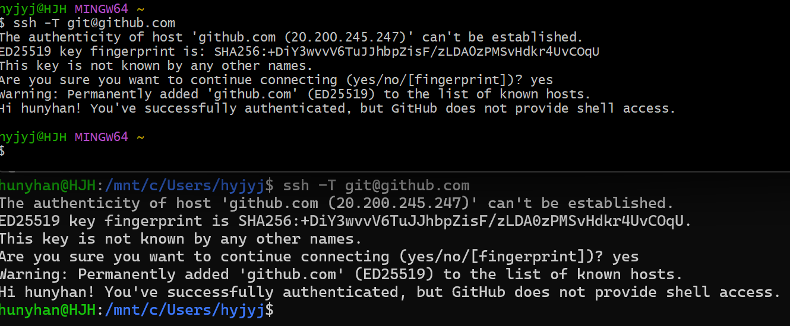
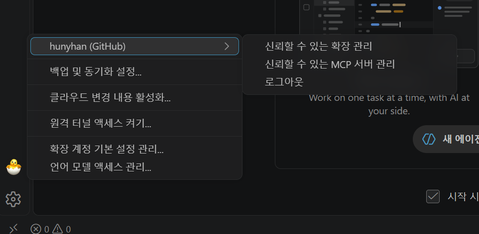
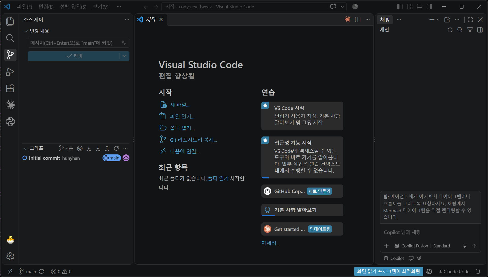
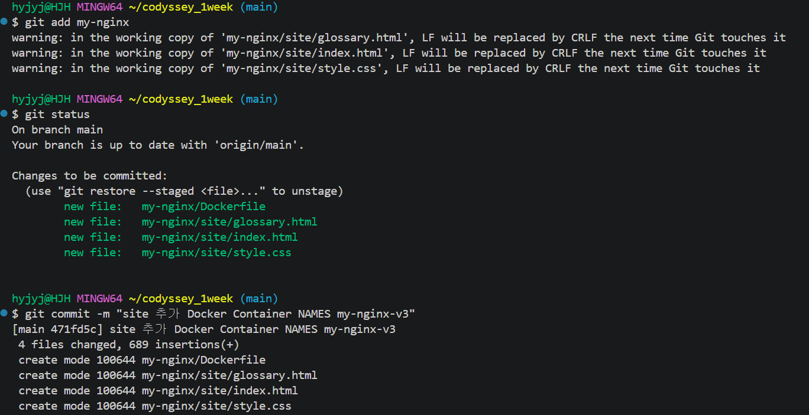
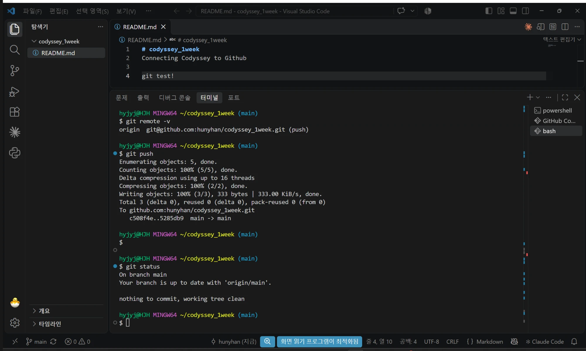
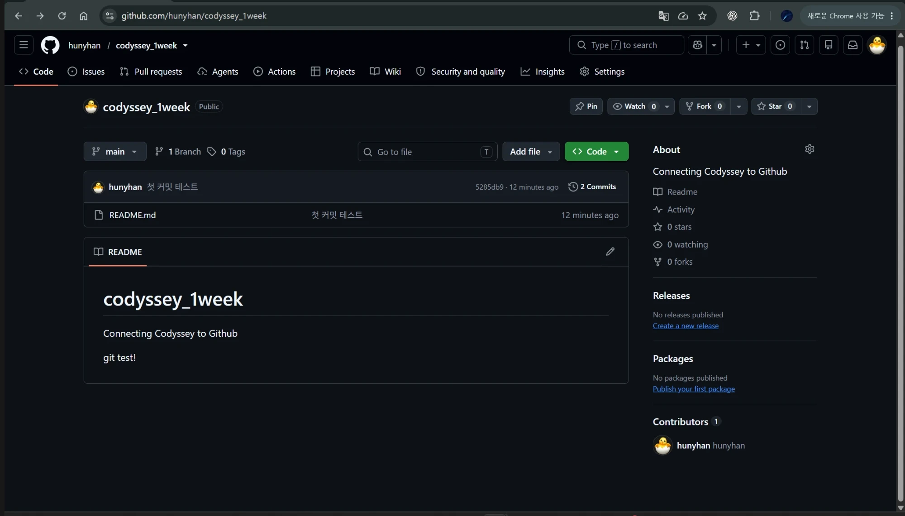

# Git 설정과 GitHub 연동

[← README로 돌아가기](../README.md)

## Git 설정

Ubuntu에서 실행했습니다. 공개 저장소이므로 `user.email` 값은 가렸습니다.

```text
$ git config --list
user.name=hunyhan
user.email=(가림)
init.defaultbranch=main
```

이 저장소의 커밋은 `--global` 없이 설정한 GitHub noreply 주소로 기록됩니다.

## SSH 키 연결



<details>
<summary>화면 원문</summary>

```text
?yjyj@HJH MINGW64 ~
$ ssh -T git@github.com
The authenticity of host 'github.com (20.200.245.247)' can't be established.
ED25519 key fingerprint is: SHA256:+DiY3wvvV6TuJJhbpZisF/zLDA0zPMSvHdkr4UvCOqU
This key is not known by any other names.
Are you sure you want to continue connecting (yes/no/[fingerprint])? yes
Warning: Permanently added 'github.com' (ED25519) to the list of known hosts.
Hi hunyhan! You've successfully authenticated, but GitHub does not provide shell access.

?yjyj@HJH MINGW64 ~
$
hunyhan@HJH:/mnt/c/Users/hyjyj$ ssh -T git@github.com
The authenticity of host 'github.com (20.200.245.247)' can't be established.
ED25519 key fingerprint is SHA256:+DiY3wvvV6TuJJhbpZisF/zLDA0zPMSvHdkr4UvCOqU.
This key is not known by any other names.
Are you sure you want to continue connecting (yes/no/[fingerprint])? yes
Warning: Permanently added 'github.com' (ED25519) to the list of known hosts.
Hi hunyhan! You've successfully authenticated, but GitHub does not provide shell access.
hunyhan@HJH:/mnt/c/Users/hyjyj$
```

</details>

## VSCode GitHub 로그인



<details>
<summary>화면 원문</summary>

```text
hunyhan (GitHub)
  신뢰할 수 있는 확장 관리
  신뢰할 수 있는 MCP 서버 관리
  로그아웃
백업 및 동기화 설정...
클라우드 변경 내용 활성화...
원격 터널 액세스 켜기...
확장 계정 기본 설정 관리...
언어 모델 액세스 관리...
```

</details>



<details>
<summary>화면 원문</summary>

```text
시작 - codyssey_1week - Visual Studio Code
소스 제어
변경 내용
메시지(Ctrl+Enter(으)로 "main"에 커밋)
커밋
그래프
Initial commit  hunyhan  main
Visual Studio Code
편집 향상됨
시작: 새 파일... / 파일 열기... / 폴더 열기... / Git 리포지토리 복제... / 다음에 연결...
최근 항목: 최근 폴더가 없습니다. 폴더 열기 시작합니다.
연습: VS Code 시작 / 접근성 기능 시작 / GitHub Cop... 새로 만들기 / 기본 사항 알아보기 / Get started ... 업데이트됨
상태 표시줄: main  0 오류  0 경고  화면 읽기 프로그램이 최적화됨  Claude Code
(이하 생략)
```

</details>

## 커밋과 SSH 푸시



<details>
<summary>화면 원문</summary>

```text
hyjyj@HJH MINGW64 ~/codyssey_1week (main)
$ git add my-nginx
warning: in the working copy of 'my-nginx/site/glossary.html', LF will be replaced by CRLF the next time Git touches it
warning: in the working copy of 'my-nginx/site/index.html', LF will be replaced by CRLF the next time Git touches it
warning: in the working copy of 'my-nginx/site/style.css', LF will be replaced by CRLF the next time Git touches it

hyjyj@HJH MINGW64 ~/codyssey_1week (main)
$ git status
On branch main
Your branch is up to date with 'origin/main'.

Changes to be committed:
  (use "git restore --staged <file>..." to unstage)
        new file:   my-nginx/Dockerfile
        new file:   my-nginx/site/glossary.html
        new file:   my-nginx/site/index.html
        new file:   my-nginx/site/style.css


hyjyj@HJH MINGW64 ~/codyssey_1week (main)
$ git commit -m "site 추가 Docker Container NAMES my-nginx-v3"
[main 471fd5c] site 추가 Docker Container NAMES my-nginx-v3
 4 files changed, 689 insertions(+)
 create mode 100644 my-nginx/Dockerfile
 create mode 100644 my-nginx/site/glossary.html
 create mode 100644 my-nginx/site/index.html
 create mode 100644 my-nginx/site/style.css
```

</details>



<details>
<summary>화면 원문</summary>

```text
README.md - codyssey_1week - Visual Studio Code
1  # codyssey_1week
2  Connecting Codyssey to Github
3
4  git test!

hyjyj@HJH MINGW64 ~/codyssey_1week (main)
$ git remote -v
origin  git@github.com:hunyhan/codyssey_1week.git (push)

hyjyj@HJH MINGW64 ~/codyssey_1week (main)
$ git push
Enumerating objects: 5, done.
Counting objects: 100% (5/5), done.
Delta compression using up to 16 threads
Compressing objects: 100% (2/2), done.
Writing objects: 100% (3/3), 333 bytes | 333.00 KiB/s, done.
Total 3 (delta 0), reused 0 (delta 0), pack-reused 0 (from 0)
To github.com:hunyhan/codyssey_1week.git
   c508f4e..5285db9  main -> main

hyjyj@HJH MINGW64 ~/codyssey_1week (main)
$

hyjyj@HJH MINGW64 ~/codyssey_1week (main)
$ git status
On branch main
Your branch is up to date with 'origin/main'.

nothing to commit, working tree clean

hyjyj@HJH MINGW64 ~/codyssey_1week (main)
$
```

</details>



<details>
<summary>화면 원문</summary>

```text
github.com/hunyhan/codyssey_1week
hunyhan / codyssey_1week
codyssey_1week  Public
main  1 Branch  0 Tags
hunyhan  첫 커밋 테스트  5285db9 · 12 minutes ago  2 Commits
README.md  첫 커밋 테스트  12 minutes ago
README
codyssey_1week
Connecting Codyssey to Github
git test!
About: Connecting Codyssey to Github
Readme / Activity / 0 stars / 0 watching / 0 forks
Releases: No releases published
Packages: No packages published
Contributors 1: hunyhan hunyhan
```

</details>

## Git과 GitHub

| | Git | GitHub |
|------|------|------|
| 역할 | 내 컴퓨터에서 변경 기록을 남기는 버전 관리 도구 | 저장소를 올려 공유하고 함께 작업하는 서비스 |
| 인터넷 | 없어도 커밋할 수 있음 | 푸시와 풀에 필요함 |
