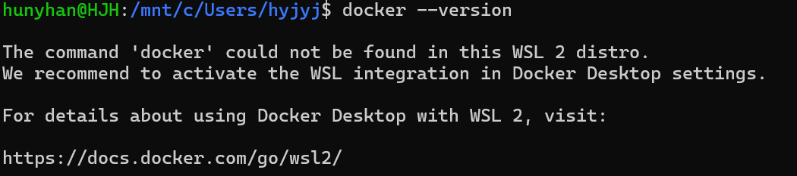
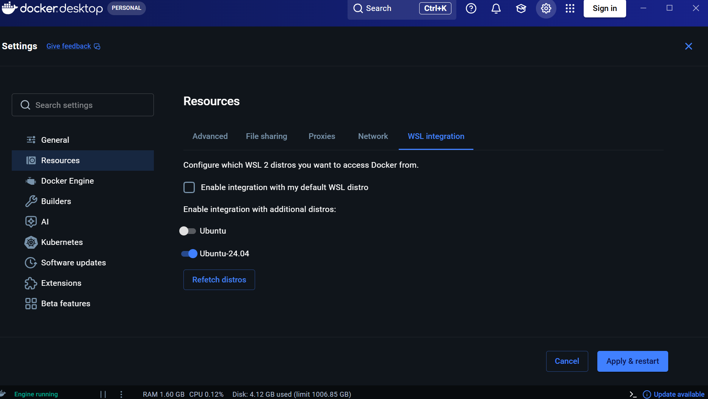
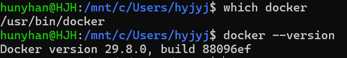
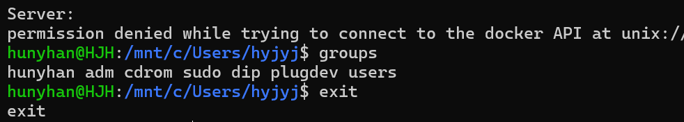
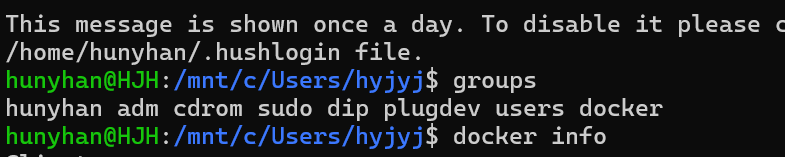
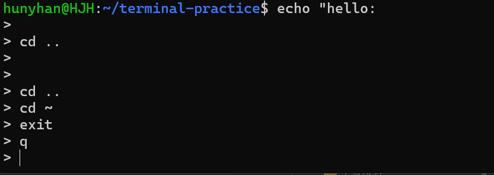
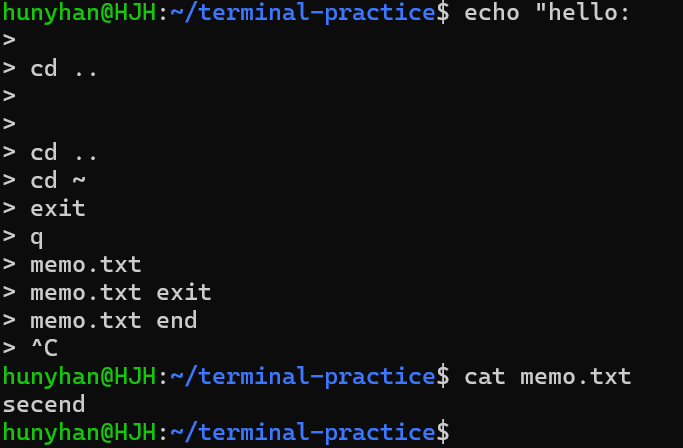
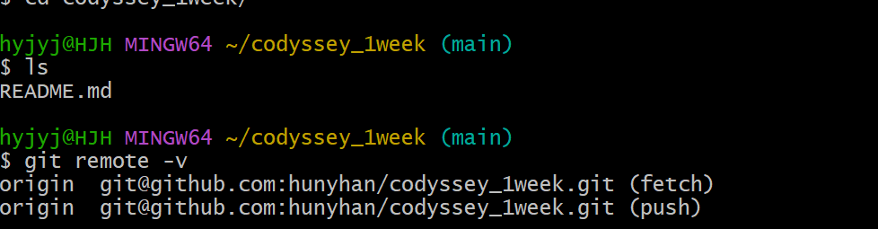
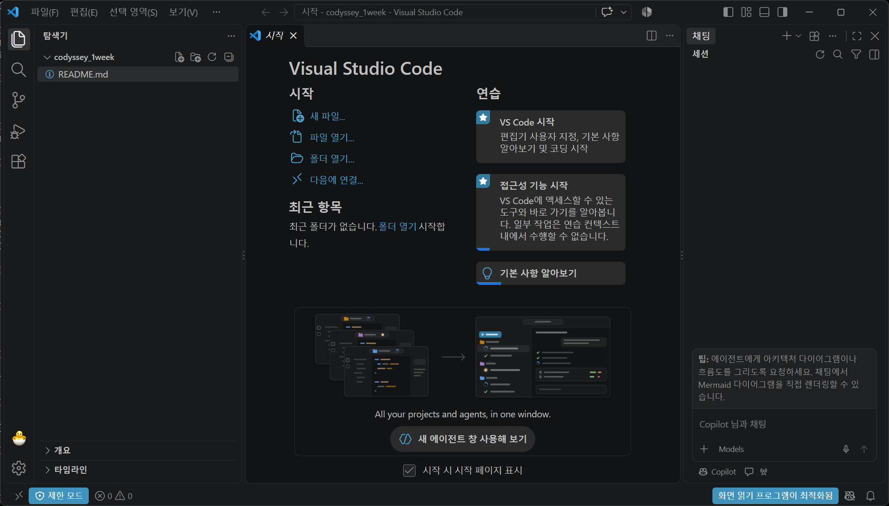

# 트러블슈팅

[← README로 돌아가기](../README.md)

형식: 문제 → 원인 가설 → 확인 → 해결

## 1. 새 Ubuntu에서 `docker`를 못 찾음

- **문제:** `docker --version` → `The command 'docker' could not be found in this WSL 2 distro.`
- **가설:** `Ubuntu-24.04` 안에 Docker 클라이언트가 없다.
- **확인:** `which docker`가 Windows 쪽 `/mnt/c/.../DockerDesktop/resources/bin/docker`를 가리켰다.
- **해결:** Docker Desktop → Settings → Resources → WSL integration에서 `Ubuntu-24.04`를 켜고 Apply & restart. `which docker`가 `/usr/bin/docker`로 바뀌었다.
- **배운 점:** 처음에는 "C드라이브 것을 그대로 공유한다"고 봤지만, 실제로는 integration이 Ubuntu 안에 클라이언트를 넣어 주어서 버전이 같다. 터미널 명령만이 아니라 GUI 설정도 확인해야 한다.



<details>
<summary>화면 원문</summary>

```text
hunyhan@HJH:/mnt/c/Users/hyjyj$ docker --version

The command 'docker' could not be found in this WSL 2 distro.
We recommend to activate the WSL integration in Docker Desktop settings.

For details about using Docker Desktop with WSL 2, visit:

https://docs.docker.com/go/wsl2/
```

</details>



<details>
<summary>화면 원문</summary>

```text
docker desktop  PERSONAL
Settings
메뉴: General / Resources (선택됨) / Docker Engine / Builders / AI / Kubernetes / Software updates / Extensions / Beta features
Resources
탭: Advanced / File sharing / Proxies / Network / WSL integration (선택됨)
Configure which WSL 2 distros you want to access Docker from.
Enable integration with my default WSL distro: 체크 안 됨
Enable integration with additional distros:
Ubuntu: 꺼짐
Ubuntu-24.04: 켜짐
버튼: Refetch distros / Cancel / Apply & restart
상태 표시줄: Engine running  RAM 1.60 GB  CPU 0.12%  Disk: 4.12 GB used (limit 1006.85 GB)  Update available
```

</details>



<details>
<summary>화면 원문</summary>

```text
hunyhan@HJH:/mnt/c/Users/hyjyj$ which docker
/usr/bin/docker
hunyhan@HJH:/mnt/c/Users/hyjyj$ docker --version
Docker version 29.8.0, build 88096ef
```

</details>

## 2. `docker info`에서 소켓 `permission denied`

- **문제:** `permission denied while trying to connect to the docker API at unix:///var/run/docker.sock`
- **가설 1:** Windows에서 만든 컨테이너라 Ubuntu에서 접근할 수 없다. → 에러는 컨테이너가 아니라 소켓에 연결하는 순간 났으므로 버렸다.
- **가설 2:** integration 전에 열린 터미널이라 그룹 권한이 반영되지 않았다.
- **확인:** 옛 창의 `groups`에 `docker`가 없었다.
- **해결:** `exit` 후 `wsl --terminate Ubuntu-24.04`, `wsl -d Ubuntu-24.04`로 다시 접속하자 `groups`에 `docker`가 생기고 `docker info`가 정상으로 나왔다.



<details>
<summary>화면 원문</summary>

```text
Server:
permission denied while trying to connect to the docker API at unix:/?
hunyhan@HJH:/mnt/c/Users/hyjyj$ groups
hunyhan adm cdrom sudo dip plugdev users
hunyhan@HJH:/mnt/c/Users/hyjyj$ exit
exit
```

</details>



<details>
<summary>화면 원문</summary>

```text
This message is shown once a day. To disable it please c
/home/hunyhan/.hushlogin file.
hunyhan@HJH:/mnt/c/Users/hyjyj$ groups
hunyhan adm cdrom sudo dip plugdev users docker
hunyhan@HJH:/mnt/c/Users/hyjyj$ docker info
?
```

</details>

## 3. 터미널이 `>`만 보여 주고 명령이 안 먹힘

- **문제:** `echo "hello:` 입력 뒤 줄마다 `>`가 나오고 `cd`, `exit`, `q`도 실행되지 않았다.
- **가설:** 명령 입력이 끝나지 않은 상태다.
- **확인:** 첫 줄의 `"`가 1개였다. 닫는 따옴표가 없어 쉘이 입력을 계속 기다렸다. 줄 앞의 `>`는 저장 기호가 아니라 계속 입력하라는 표시다.
- **해결:** `Ctrl+C`로 취소했다. 실행되지 않았으므로 파일 내용은 그대로였다.



<details>
<summary>화면 원문</summary>

```text
hunyhan@HJH:~/terminal-practice$ echo "hello:
>
> cd ..
>
>
> cd ..
> cd ~
> exit
> q
>
```

</details>



<details>
<summary>화면 원문</summary>

```text
hunyhan@HJH:~/terminal-practice$ echo "hello:
>
> cd ..
>
>
> cd ..
> cd ~
> exit
> q
> memo.txt
> memo.txt exit
> memo.txt end
> ^C
hunyhan@HJH:~/terminal-practice$ cat memo.txt
secend
hunyhan@HJH:~/terminal-practice$
```

</details>

## 4. `ssh -T`가 아무 출력 없이 멈춤

키 발급 명령은 다음과 같습니다. `-C`의 값은 키에 붙이는 설명이고 접속 주소가 아닙니다.

```bash
ssh-keygen -t ed25519 -C "이메일"
```

- **문제:** Git Bash와 Ubuntu 모두 `ssh -T`를 실행하자 프롬프트로 돌아오지 않았다.
- **가설:** 키 발급 때 이메일을 쓴 경험 때문에 접속 명령에도 이메일을 입력했다.
- **확인:** 안내된 명령과 비교하니 `git@github.com` 자리에 이메일 주소를 썼다. `ssh`는 `사용자@서버`로 읽어 이메일 회사 서버에 접속하려 했다.
- **해결:** `Ctrl+C`로 빠져나와 `ssh -T git@github.com`을 실행했다. 호스트 지문을 GitHub 공식 문서와 비교한 뒤 `yes`를 입력해 `Hi hunyhan!`을 확인했다.

## 5. `fatal: not a git repository`

- **문제:** clone 뒤 `git remote -v`가 `fatal: not a git repository`를 출력했다.
- **가설:** clone 폴더로 들어가지 않고 홈에서 실행했다.
- **확인:** 프롬프트가 `~`였고 홈에는 `.git`이 없었다. clone 폴더의 `ls -a`에는 `.git/`이 있었다.
- **해결:** `cd codyssey_1week`로 들어가자 프롬프트에 `(main)`이 나오고 `origin` 주소가 출력됐다.



<details>
<summary>화면 원문</summary>

```text
$ cd codyssey_1week/

hyjyj@HJH MINGW64 ~/codyssey_1week (main)
$ ls
README.md

hyjyj@HJH MINGW64 ~/codyssey_1week (main)
$ git remote -v
origin  git@github.com:hunyhan/codyssey_1week.git (fetch)
origin  git@github.com:hunyhan/codyssey_1week.git (push)
```

</details>

## 6. VSCode에 브랜치가 안 보임

- **문제:** 폴더를 열었는데 왼쪽 아래에 `main`이 보이지 않았다.
- **가설:** 창에서 표시줄이 잘렸거나 VSCode가 Git 기능을 쓰지 않는다.
- **확인:** 표시줄이 보이게 하자 `제한 모드`가 있었다. 제한 모드에서는 Git 기능이 꺼진다.
- **해결:** `제한 모드`를 눌러 내 저장소임을 확인하고 신뢰했다. 왼쪽 아래에 `main`이 나타났다.
- **브랜치:** 커밋이 이어지는 작업 줄기의 이름이다. `main`은 기본 브랜치이고, 프롬프트의 `(main)`은 지금 작업 중인 브랜치를 뜻한다.



<details>
<summary>화면 원문</summary>

```text
시작 - codyssey_1week - Visual Studio Code
탐색기
codyssey_1week
README.md
Visual Studio Code
시작: 새 파일... / 파일 열기... / 폴더 열기... / 다음에 연결...
최근 항목: 최근 폴더가 없습니다. 폴더 열기 시작합니다.
연습: VS Code 시작 / 접근성 기능 시작 / 기본 사항 알아보기
All your projects and agents, in one window.
새 에이전트 창 사용해 보기
시작 시 시작 페이지 표시 (체크됨)
상태 표시줄: 제한 모드  0 오류  0 경고  화면 읽기 프로그램이 최적화됨
(이하 생략)
```

</details>
